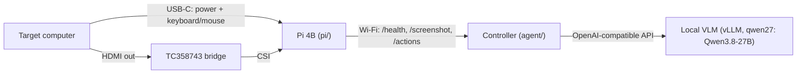

# ai-kvm

Hardware computer use for agents. A Raspberry Pi 4B plugs into a computer like a person would: its USB-C port
is a keyboard + mouse, and an HDMI-to-CSI bridge captures the screen. A controller on the local network (here
the GB10, which also serves the vision model) watches the KVM and drives the computer. Nothing is installed on
the target.



## Plug and play

Plug the KVM's USB-C and HDMI into a Mac. The Pi boots from the Mac's USB power (~13 s to Wi-Fi) and
`ai-kvm-agent` on the controller notices the new session (new boot, USB host, or HDMI signal) and runs
`agent.setup.first_contact`:

1. First plug-in on a given Mac: macOS asks "What do you want to show on ai-kvm?" (the EDID is TV-class). The
   capture shows the "Choose to Mirror or Extend" card, so the controller presses Return: Entire Screen.
2. macOS then mirrors with the KVM as master, putting the Mac's own panel at 720p. The controller opens
   Apple menu > System Settings (fixed 720p positions), Hide Others, cmd+F "Displays", sets "Optimize for" to the
   Mac itself (two vision-grounded clicks), Show All, and closes the window. The panel is back at native
   resolution and the KVM mirrors it (pillarboxed). macOS remembers this per display, so later plug-ins into
   the same Mac skip steps 1-2.
3. Pointer check: the cursor is located in the capture by frame differencing and must land where it was sent.

The state is in `/run/ai-kvm/state.json` (`ready` / `needs attention` with a report) and the journal
(`journalctl -u ai-kvm-agent@<user>`). Failed setups are retried while the session lasts (click-free failures up to
5 times, failures that clicked around System Settings once).

Measured on a MacBook Air (macOS 26.4):

| Path | Setup time | Mac panel at 720p |
|---|---|---|
| Known Mac (re-plug) | 3.5-4 s after the Pi is reachable | never |
| New Mac (first plug) | 20-25 s after the Pi is reachable | 16-18 s |

The Pi is reachable ~24-28 s after a warm reboot (12.9 s boot + Wi-Fi association; a cold plug-in skips the
shutdown). Automatic new-display trials: 5/5 and 3/3 after the last fixes.

## Using it

    python3 -m agent "In the Helium web browser, go to connectionsunlimited.org, click New Game and solve it"

This is native computer use: the model (Claude via the omp gateway, `--model`) drives the computer through the
standard `computer` tool it was trained on (`left_click`, `type`, `key`, `scroll`, `zoom`, `screenshot`, ...), the
way its own computer-use agent works (`agent/cu.py`). It sees a screenshot, calls the tool as often as it likes
(several calls per turn when it is confident: four tiles and Submit in one go), gets a screenshot back once the
screen has settled, and stops when the task is done. No planner prompt of ours, no action grammar, no grounder.
Measured on the Mac: a Connections puzzle in 17 turns / 88 s, "what is on my calendar today" in 4 turns / 14 s.

The grounded planner loop is still there as `python3 -m agent.run` (`plan` + steps with `expect`, Holo4 grounding
of described targets, local verification of each step; the path the MCP `act` tool uses). It takes 2-4 s of model
time per step and is the better fit for models that are weak at pixel coordinates.

Keystrokes are what can do damage on someone's computer, so (both loops):

- If the task names an app, it is brought to the front before the first look, through the OS launcher
  (Spotlight, or Raycast/Alfred when they own cmd+space; the Start/Activities search elsewhere). Nothing is
  typed until a launcher is seen open, and Enter is pressed only when its top result is that app. On macOS the
  menu bar must then name it the active app (a cold start keeps the previous app active for seconds) before
  every other app is hidden (Hide Others) until the run ends, when Help > Search runs "Show All". The model can
  call `open_app` itself later.
- Keys need a click on their target earlier in the same batch, except right after `open_app`. Typed text also
  needs a click or a focus shortcut (cmd+t, cmd+l, cmd+f, ...) before it, in the same batch or ending the
  previous one: letters typed into a page fire its one-key shortcuts.
- An Enter after typed text is gated: the model names the input holding the text, then judges whether the task
  wants it there, so a chat box or terminal that happened to have focus never gets it sent (checked 5/5 each on
  a chat composer with a search task, the same composer with a posting task, and a browser address bar).
- No click is grounded on ustreamer's NO SIGNAL picture; the same batch three times in a row (refused ones
  included) ends the run.

This costs ~3.5 s to open the app, ~2.5 s to show the other apps again and ~1 s per gated Enter: a search task
from a cluttered desktop (terminal floating on top, App Store in front of the browser) takes 13-17 s end to end.

The Pi's own API (`pi/api/server.py`) is usable directly: `GET /health`, `GET /screenshot`,
`POST /actions` with move/click/drag/scroll/type/key/wait batches.

## The KVM as an MCP server, Droid as the planner

The computer under control is also exposed as an MCP server running **on the KVM** (`agent/kvm_mcp.py`,
`ai-kvm-mcp.service`, streamable HTTP on `:8090/mcp`). Any MCP client gets these tools and nothing else:

| tool | what it does |
| --- | --- |
| `begin(task)` | starts a run: run folder (`/var/lib/ai-kvm/runs/<id>/` with every frame and `events.jsonl`), the rules of the computer, the screenshot, and the overview of every open window (which apps the user already uses) |
| `computer(action, ...)` | the standard computer tool: one action (`left_click`, `type`, `key`, `scroll`, `zoom`, `screenshot`, ...), then the screenshot once the screen has settled |

So a Droid session drives the computer exactly like `python3 -m agent` does (same tool, same rules, same Enter
gate); the grounded `act` path is only in `agent/run.py`. Only `screenshot`/`zoom` return an image, so a batch of
actions costs one capture like the direct loop; `end` hands the lessons to memory in the background. Measured on
the same task (new tab, read the top of Hacker News) with the gateway's per-request trace (`OMP_GATEWAY_TRACE=1`):
direct 15 s in 2 model calls; through Droid ~25 s in 6 model calls. The KVM side is ~4 s either way. Droid's extra
is structural: it wraps every MCP call in its `Script` tool (12 KB of tool schemas on every request, code instead
of a tool call), adds a title-generation call, and always spends a closing turn after the last tool result.
Per screenshot, the next action lands on the computer 2-4 s later on both paths: 90% of that is the model
deciding, the KVM adds ~0.1 s to act and 0.25-2 s to let the screen settle. Planner A/B on this task, 3 runs each:
Sonnet 5.5 (default now) 8.5-11.5 s direct / 23-31 s Droid, 2.0-2.9 s per decision, 3/3 correct on both paths;
Opus 5.5 10-17 s / 29-30 s, 2.5-4.0 s per decision; Haiku 5.5 fastest per call (1.4-2.7 s) but failed every Droid
run and was erratic direct. Droid stays a constant ~3x the direct loop whatever the planner (6-7 model calls vs 2).

The rails live inside the server, so they bind every planner the same way: off-screen points are refused with an
error result, and Enter after typed text is gated on where the text landed (judged by qwen27 on the controller,
reached from the KVM over the dev AP: `provisioning/host/ai-kvm-models.service` forwards it, and forwards the MCP
port to Tailscale peers).

**Where Droid runs.** [Factory's Droid](https://docs.factory.ai/sdk/python) is the planner: `agent/droid.py`
opens a Droid SDK session whose only reachable surface is this MCP server: Droid's shell, file and web tools are
removed from the session (`disabled_tools`, the hard gate), the permission handler approves only `ai-kvm` tool
calls and the wrappers Droid calls them through (a global auto-approve hook on this machine pre-empts it, so it
is a second line, not the first), and the rails on the KVM bound what any approved call can do. The session is
streamed to the report.

    .venv-droid/bin/python -m agent.droid "In the Helium browser, go to example.com and report the heading"
    .venv-droid/bin/python -m agent.droid --inbox /var/lib/ai-kvm/inbox     # the trigger

The trigger is the inbox: drop `<name>.task` (a text file with the task) and a run starts as soon as the KVM
daemon reports the computer ready (`/run/ai-kvm/state.json`); `<name>.report.md` (every tool call, every
refusal and verdict, every frame Droid saw, token and credit usage) and `<name>.events.jsonl` land next to it.
A cron, an HTTP hook or another agent only needs to write a file. One-off runs write `runs/<timestamp>.report.md`.

Droid's models come through BYOK (`~/.factory/settings.json` custom models pointing at `agent/omp_gateway.py`,
the local Anthropic/OpenAI-compatible front for the models omp is logged into), so a run costs no Factory credits.
The same server is registered in the Factory desktop app on the Mac as connector `ai-kvm` (added by this agent
driving the app over the KVM). A plain app session carries Factory's full toolset (19 tools, 38 KB of schemas on
every model call, measured through the gateway trace), which is what makes it slow; `droids/computer.md` is a
custom droid whose only surface is the `ai-kvm` connector (`tools: []`, `mcpServers: ["ai-kvm"]`): install it
as `~/.factory/droids/computer.md` on the Mac and pick it in the app.

Deploy to the KVM: `bash agent/deploy-mcp.sh` (rsyncs the `agent` package, builds the venv from offline wheels,
installs the key and the unit).

## Memory: it learns your machine (Moss)

Every run ends by distilling what it established into a few falsifiable notes ("Factory app: the Connectors
button at the bottom of the main window opens the MCP list; HTTP is the default transport"), stored in a Moss
index with the computer, outcome and timestamp (`agent/memory.py`, service `ai-kvm-memory`, Moss sessions:
local index synced to Moss Cloud). The next run on that computer recalls the relevant notes in ~5 ms
(hybrid search, filtered to successful, non-quarantined notes) and gets them as rules. A failed run that
followed a note and found it wrong quarantines it; a later success re-asserts it. Only lessons from successful
runs are stored; typed text and task text never are.

Measured on the Factory MCP task above: cold 8 turns / 34 s, warm (3 notes recalled) 5 turns / 20 s.
Both `python3 -m agent` and the KVM's MCP server (`begin` recalls, `end(outcome, summary)` learns) use it;
credentials in `/etc/ai-kvm/moss.env` (root-only).

## Setup

- Pi: `provisioning/README.md` (flash, `pi/install.sh`, `pi/net/use-networkd.sh`).
- Controller: `sudo provisioning/dev-ap/install.sh <wlx...> <psk-file>` (Wi-Fi AP the Pi joins) and
  `sudo agent/install.sh <user>` (the auto-setup daemon; reads the vLLM key via systemd `LoadCredential`).
- `host/macos/kvm-mirror.swift` does step 2 through CoreGraphics when you have a shell on the Mac (dev/recovery).

## Limits

- Auto-setup is macOS-only. Windows/Linux extend a new display by default: set the KVM display to Duplicate once
  (Windows: Win+P). The setup recognizes a non-Mac and reports this instead of clicking.
- "KVM is master" is judged by aspect ratio (the Mac panel is pillarboxed when it is master), which fits every
  MacBook; a 16:9 iMac looks the same either way.
- The keyboard identifies as an Apple keyboard (no Keyboard Setup Assistant), so F1-F12 are media keys on macOS.
- Capture is 720p60 over 2 CSI lanes.

## Actor training data

Each sample is `(screenshot ≤1280px, instruction, one action)`. Actions are JSON with coordinates 0–1000 relative to the
screenshot (`shared/actions.py` is the schema; `shared/actor_prompt.txt` is the prompt used in training and inference).
`actions.to_pi()` converts to the Pi control API.

| Source | Script | Labels from | Human work |
|---|---|---|---|
| `osatlas` | `datagen/osatlas_convert.py` | OS-Atlas desktop set (Apache-2.0), range-read from HF | none |
| `web` | `datagen/web_grounding.py` | DOM boxes of live pages (headless Chromium) | none |
| `templates` | `datagen/action_templates.py` | key combo / scroll / type templates on real frames | none |
| `ax` | `datagen/ax_grounding.py` | macOS accessibility tree | drive apps into varied states |
| `gold` | `datagen/gold_label.py` | hand labels on Pi HDMI captures | ~200 labels, **eval only** |
| `teacher` | agent teacher mode (todo) | Droid trajectories | review flagged episodes |

`datagen/rephrase.py` rewrites click instructions into the planner's voice with Claude and flags bad labels.
`datagen/preview.py` draws targets on frames for spot checks.

```bash
uv venv --python 3.12 .venv && uv pip install -p .venv -r datagen/requirements.txt && .venv/bin/playwright install chromium
bash datagen/round1.sh            # osatlas + web + templates (+ rephrase if ANTHROPIC_API_KEY) -> data/export/
```
Training on Vultr: `training/RUNBOOK.md`. Data lives in `data/` (gitignored).
