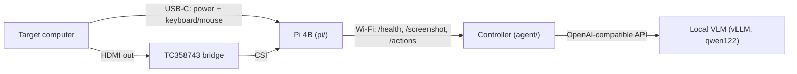

# ai-kvm

Hardware computer use for agents. A Raspberry Pi 4B plugs into a computer like a person would: its USB-C port
is a keyboard + mouse, and an HDMI-to-CSI bridge captures the screen. A controller on the local network (here
the GB10, which also serves the vision model) watches the KVM and drives the computer. Nothing is installed on
the target.

## Plug and play

Plug the KVM's USB-C and HDMI into a Mac. The Pi boots from the Mac's USB power (~13 s to Wi-Fi) and
`ai-kvm-agent` on the controller notices the new session (new boot, USB host, or HDMI signal) and runs
`agent.setup.first_contact`:

1. First plug-in on a given Mac: macOS asks "What do you want to show on ai-kvm?" (the EDID is TV-class). The
   capture shows the "Choose to Mirror or Extend" card, so the controller presses Return: Entire Screen.
2. macOS then mirrors with the KVM as master, putting the Mac's own panel at 720p. The controller opens
   Apple menu > System Settings (fixed 720p positions), Hide Others, cmd+F "Displays", sets "Optimize for" to the
   Mac itself (two vision-grounded clicks), Show All, and closes the window. The panel is back at native
   resolution and the KVM mirrors it (pillarboxed). macOS remembers this per display, so later plug-ins into
   the same Mac skip steps 1-2.
3. Pointer check: the cursor is located in the capture by frame differencing and must land where it was sent.

The state is in `/run/ai-kvm/state.json` (`ready` / `needs attention` with a report) and the journal
(`journalctl -u ai-kvm-agent@<user>`). Failed setups are retried while the session lasts (click-free failures up to
5 times, failures that clicked around System Settings once).

Measured on a MacBook Air (macOS 26.4):

| Path | Setup time | Mac panel at 720p |
|---|---|---|
| Known Mac (re-plug) | 3.5-4 s after the Pi is reachable | never |
| New Mac (first plug) | 20-25 s after the Pi is reachable | 16-18 s |

The Pi is reachable ~24-28 s after a warm reboot (12.9 s boot + Wi-Fi association; a cold plug-in skips the
shutdown). Automatic new-display trials: 5/5 and 3/3 after the last fixes.

## Using it

    python3 -m agent "In the Helium web browser, open a new tab and search for raspberry pi kvm"

One model call per step: the model sees the screen picture (pillarbox removed) and replies with batched
actions, constrained to a JSON schema (vLLM structured outputs) so every reply parses; clicks carry a target
description and a 0-1000 `point_2d`. Typical step: 1.3-2 s of model time plus execution. After acting, the
next screenshot is taken once the screen stops changing (page loads get the time they need, at most
`--settle-max`). `--dry-run` asks the model without sending input; `--save-dir` keeps every frame.

Keystrokes are what can do damage on someone's computer, so:

- If the task names an app, it is brought to the front before the first look, through the OS launcher
  (Spotlight, or Raycast/Alfred when they own cmd+space; the Start/Activities search elsewhere). Nothing is
  typed until a launcher is seen open, and Enter is pressed only when its top result is that app. On macOS the
  menu bar must then name it the active app (a cold start keeps the previous app active for seconds) before
  every other app is hidden (Hide Others) until the run ends, when Help > Search runs "Show All". The model can
  call `open_app` itself later.
- Keys need a click on their target earlier in the same batch, except right after `open_app`. Typed text also
  needs a click or a focus shortcut (cmd+t, cmd+l, cmd+f, ...) before it, in the same batch or ending the
  previous one: letters typed into a page fire its one-key shortcuts.
- An Enter after typed text is gated: the model names the input holding the text, then judges whether the task
  wants it there, so a chat box or terminal that happened to have focus never gets it sent (checked 5/5 each on
  a chat composer with a search task, the same composer with a posting task, and a browser address bar).
- No click is grounded on ustreamer's NO SIGNAL picture; the same batch three times in a row (refused ones
  included) ends the run.

This costs ~3.5 s to open the app, ~2.5 s to show the other apps again and ~1 s per gated Enter: a search task
from a cluttered desktop (terminal floating on top, App Store in front of the browser) takes 13-17 s end to end.

The Pi's own API (`pi/api/server.py`) is usable directly: `GET /health`, `GET /screenshot`,
`POST /actions` with move/click/drag/scroll/type/key/wait batches.

## Setup

- Pi: `provisioning/README.md` (flash, `pi/install.sh`, `pi/net/use-networkd.sh`).
- Controller: `sudo provisioning/dev-ap/install.sh <wlx...> <psk-file>` (Wi-Fi AP the Pi joins) and
  `sudo agent/install.sh <user>` (the auto-setup daemon; reads the vLLM key via systemd `LoadCredential`).
- `host/macos/kvm-mirror.swift` does step 2 through CoreGraphics when you have a shell on the Mac (dev/recovery).

## Limits

- Auto-setup is macOS-only. Windows/Linux extend a new display by default: set the KVM display to Duplicate once
  (Windows: Win+P). The setup recognizes a non-Mac and reports this instead of clicking.
- "KVM is master" is judged by aspect ratio (the Mac panel is pillarboxed when it is master), which fits every
  MacBook; a 16:9 iMac looks the same either way.
- The keyboard identifies as an Apple keyboard (no Keyboard Setup Assistant), so F1-F12 are media keys on macOS.
- Capture is 720p60 over 2 CSI lanes.
